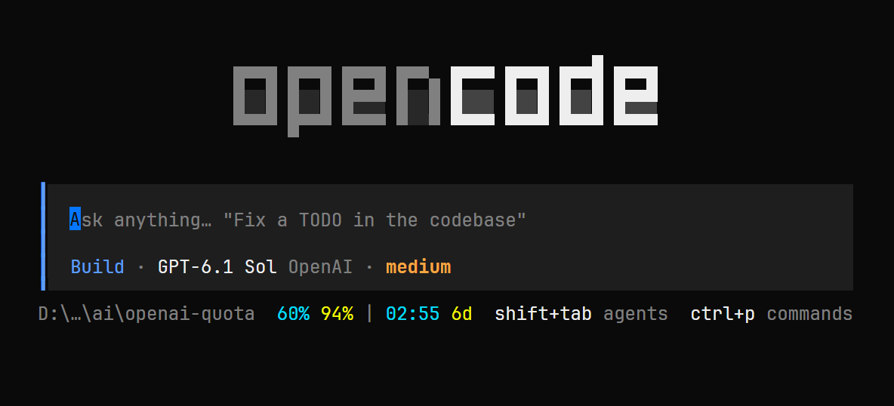

# ⚡ OpenAI Quota for OpenCode


Your ChatGPT quota, right in the OpenCode footer. Remaining **5-hour & 7-day limits**, reset countdowns, and customizable colors — without leaving the terminal. ✨



## 🚀 Install

**1. Clone and install dependencies**

```sh
git clone https://github.com/mykola-dev/openai-quota.git
cd openai-quota
npm ci --ignore-scripts
```

**2. Add the checkout to your global `~/.config/opencode/opencode.json`**

Merge this entry with your existing plugins, using the **absolute path** to the cloned folder:

```jsonc
{
  "$schema": "https://opencode.ai/config.json",
  "plugins": ["/absolute/path/to/openai-quota"]
}
```

On Windows, use forward slashes: `D:/dev/ai/openai-quota`.

**3. Run `/reload`, select an OpenAI model, and you're set. 🎉**

Requires OpenCode V2 (tested on **2.2.3**), a ChatGPT subscription connected through the device-code method below, and Node.js **26.4.0+** for the install command above. No separate API key needed.

## 🔑 Connect your ChatGPT subscription

**Choose the device-code login, not the regular “Sign in with ChatGPT” browser flow.** That newer browser flow can connect your account for model use but does not expose numeric quota to this plugin.

1. Run `/connect` and select **OpenAI**.
2. Choose **Codex device code (legacy)** — the method that displays an **8-character code**.
3. Open the authorization URL shown by OpenCode, sign in to the ChatGPT account with your subscription, and enter that code. The device-code flow still uses a browser for approval; the important part is choosing the **device-code method** in OpenCode.
4. Return to OpenCode and wait for authentication to finish. If you have multiple OpenAI connections, make this connection active.
5. Run `/models`, select an OpenAI model, then run `/quota` to check your limits. ✅

Never paste your login code or tokens into an issue or chat.

## 🎨 Make it yours

Open the command palette → **OpenAI quota → Settings** to edit the template, hex/RGBA colors, or preview your layout. Settings are saved automatically. Use `/quota` to refresh manually.

Default template:

```text
{percent5h} {percent7d} | {reset5h} {reset7d}
```

Add any prefix or separators as plain text. Cyan is the 5-hour window; yellow is the 7-day window. 🩵 💛

> **Heads up:** device-code login is not a guarantee that quota will be available for every account. If your connection doesn't expose numeric quota, the plugin shows `—`; `/quota` provides the ChatGPT usage-page URL. This is an unofficial plugin using an undocumented endpoint, so availability may change.
